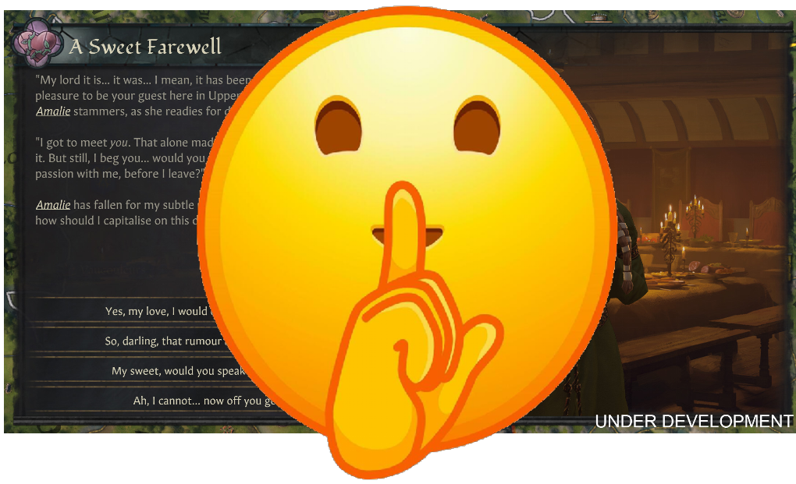

# Current Mod Description (As Shown on Steam):
### *Currently Supports Game Version 1.20.\**

# What It Does
### Events:
This mod converts multiple frequently occurring events that require intervention by the player into smaller toasts/notifications. Thus getting them out of your way so you can actually enjoy the game.
### Game Rules:
There's a game rule to switch between the modded version of events and the base game version.
  - Every 'Quieted Event' has a rule to switch back to vanilla.
  - Mod game rules are grouped via mod name & are fully localized.
### Message Settings Filter:
I've now put all the modified events into the mods own custom messages.
  - Modded events now share custom message filter and can be filtered together in message log.
  - Modded events can now be toggled (together) between ***Toast/Feed/Popup/Hidden*** via Message Settings.

# Current Events Affected
* **Spymaster found Secret Unbeliever**: Spymaster found secret unbeliever in your court and notifies you.
* **Vassal Imprison Attempt succeeded**: When your attempt to imprison a vassal succeeds.
* **Marriage Accepted Letter**: Just like Prisoner release, we know when we send offer, so no need to get a large reply.
* **A Seduction Scheme at Court**: Spymaster notifies player of ongoing scheme against character at court.
* **Schemer Discovered**: Your spymaster has discovered the schemer, but you can't take action. If you can imprison the schemer (i.e. they're your courtier/vassal), you still get the event.
* **A Snake at Court**: Attempted seduction of courtier & ongoing affair between courtier and someone else. Still uses the games random insults that Less Event Spam mod used...may change in the future.
* **Child of My Dynasty**: Sends a simple toast message with the ai chosen name and who the mother is instead of the larger window and prompting you to name using the widgets.
* ~~**A Fresh Start**~~: Removed as base game no longer fires this anyway as of 1.20.

# Latest Update!
The way I overrode events before via entire files is no longer needed due to 1.20 so I updated to the new way. Now I ONLY override/maintain the specific events I call out below, so there should be much improved compatibility with other mods and less bugs with game updates.

# Compatibility
**This mod only overrides the specific events listed in the event section via override priority. So as long as the other mod doesn't touch those event's (it can theoretically replace the file) that's still fine as long as they don't set a higher priority number.**
## Localization
English, Russian, German, Chinese.
